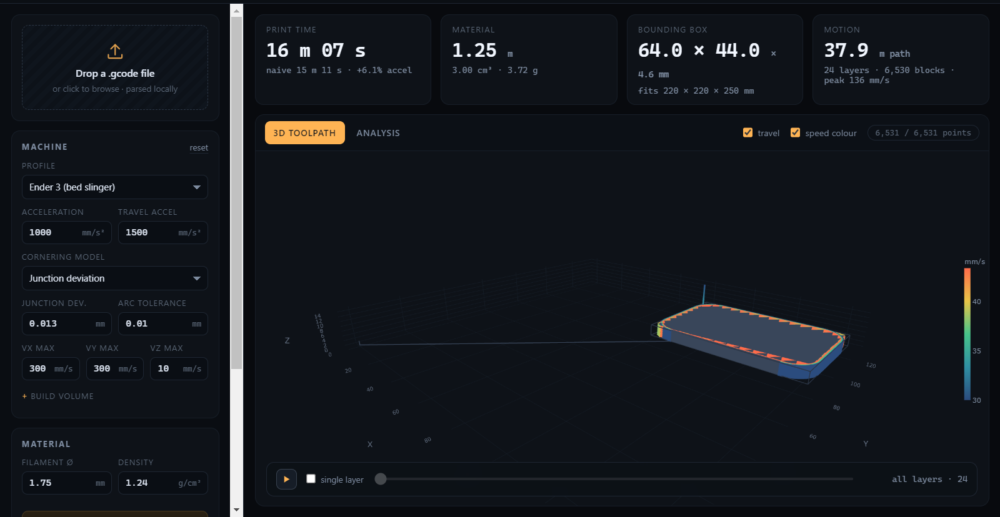

# G-code Toolpath Analyser

**Read a `.gcode` file, interpolate its exact toolpath, and get engineering numbers you can actually plan with — acceleration-limited print time, filament volume and mass, and bounding-box dimensions — next to an interactive 3D view of the path coloured by planned speed.**




---

## Why

`distance ÷ feedrate` is wrong, and it is wrong in the direction that costs you
money. Every corner forces the machine to slow down and speed back up, so any
toolpath with detail prints slower than the naive figure — often 5–30 % slower,
and much more on small, intricate parts.

Slicer ETAs hide this behind an opaque number tied to one machine profile. This
tool does the opposite: it replays the file through a real motion planner, shows
the planned time *and* the naive baseline, and lets you change acceleration,
cornering model, axis limits and material properties to see what actually moves
the number.

## What you get

- **Exact interpolation** — `G0/G1` lines and true `G2/G3` arcs (IJK and R forms,
  every plane, full circles, helical Z), subdivided with a bounded chordal
  deviation just like firmware.
- **Real kinematics** — per-block speed ceilings, junction-deviation (Marlin 2 /
  PrusaSlicer) or classic jerk cornering, forward/backward passes, and
  trapezoidal block integration. Barriers (dwells, tool changes, homing) stop
  the machine, as they do in reality.
- **Material numbers** — filament length, volume and mass from E values,
  filament diameter and density; retracted/primed filament tracked separately.
- **Envelope checks** — bounding box of the deposited part and of the full
  motion envelope, checked against the build volume.
- **An honest breakdown** — print vs travel vs dwell vs retraction time, time
  per layer, time by feedrate, peak/mean speed and volumetric flow.
- **A view you can inspect** — speed-coloured 3D path, travel toggle, envelope
  box, single-layer isolation and playback, all in the browser.
- **Local by default** — nothing is uploaded anywhere; Plotly is vendored, so it
  works offline.

## Quick start

```bash
pip install -r requirements.txt
python run.py
# G-code toolpath analyser
#   serving http://localhost:8000
```

Open <http://127.0.0.1:8000>, drop a `.gcode` file anywhere in the window, or
load one of the bundled samples (`rounded_plate.gcode`, `arc_torture.gcode`).
Change machine parameters on the left and the file is re-planned on the server
without re-uploading.

```bash
python run.py --port 9000
python run.py --host 0.0.0.0   # expose on the local network
```

## Command line

```bash
python -m gcode_analyzer.cli samples/rounded_plate.gcode
```

```
==================================================================
 G-CODE ANALYSIS  rounded_plate.gcode
==================================================================
 lines: 2,068   slicer: PrusaSlicer   segments: 6,530   analysed in 89 ms

 TIME  (acceleration-limited motion planning)
   total                     15m 50.6s   naive distance/speed 15m 11.1s
   printing                  14m 46.3s
   travelling                   59.95s
   retractions                   4.37s
   accel overhead                 4.3%

 MATERIAL
   filament                   1.246 m   (retracted 95.2 mm)
   volume                     2.997 cm3
   mass                        3.72 g   @ 1.24 g/cm3, 1.75 mm filament

 BOUNDING BOX
   size                64.00 x 44.00 x 4.60 mm

 MOTION
   path                      37.907 m   (print 33.312 m / travel 4.596 m)
   layers                        24   layer height 0.2 mm
   arcs                         288   arc length 4.319 m
   peak speed                 141.3 mm/s   mean print 38.0 mm/s
   peak flow                   3.90 mm3/s   mean flow 3.38 mm3/s
   retractions                  119   tool changes 0
==================================================================
```

Useful flags:

```bash
python -m gcode_analyzer.cli part.gcode --accel 2000 --junction-deviation 0.02
python -m gcode_analyzer.cli part.gcode --junction-model jerk --jerk 8
python -m gcode_analyzer.cli part.gcode --json metrics.json
python -m gcode_analyzer.cli part.gcode --html report.html   # self-contained
```

`--html` writes a standalone Plotly report with the library inlined — one file
you can email, archive or open offline.

## How the timing model works

1. Every block gets a unit direction vector and a speed ceiling: the commanded
   feed, clipped by the per-axis velocity limits.
2. Each junction gets a cornering speed — junction deviation by default
   (`v² = a·δ·sin(θ/2) / (1 − sin(θ/2))`), or classic per-axis jerk
   (`v ≤ jerk / max|u|`).
3. A forward pass limits each junction by how much the machine can accelerate
   into it; a backward pass limits it by how much it can decelerate out.
4. Each block is integrated as a trapezoid (or triangle when it is too short to
   reach the ceiling) between its entry and exit speeds.

The result is always at least the naive time, and the difference is reported as
the acceleration overhead.

## API

| Method | Path | Purpose |
| --- | --- | --- |
| `GET` | `/api/health` | liveness and web-asset check |
| `GET` | `/api/samples` | list bundled samples |
| `POST` | `/api/analyze` | raw G-code body, `x-filename` header, config in the query string |
| `POST` | `/api/samples/{name}` | analyse a bundled sample |
| `POST` | `/api/replan/{id}` | re-run a cached analysis with `{"config": {…}}` |

Config keys mirror `gcode_analyzer.models.Config`: `accel`, `travel_accel`,
`junction_deviation`, `jerk`, `junction_model` (`deviation` \| `jerk`),
`max_vx`, `max_vy`, `max_vz`, `arc_tolerance`, `max_points`,
`filament_diameter`, `density`, `build_x/y/z`, `tool_change_time`,
`retract_time`.

## Architecture

```
gcode_analyzer/
  models.py         Config, Move, Segment, FileInfo (validated settings)
  parser.py         streaming modal G-code parser (state in, Move events out)
  geometry.py       arc maths: IJK/R centres, planes, helical Z, chordisation
  planner.py        junction speeds, forward/backward passes, block integration
  analyzer.py       orchestration: metrics, layer/feed tables, render payload
  api.py            FastAPI app: upload, re-plan, samples, static hosting
  cli.py            terminal report and self-contained Plotly HTML export
web/
  index.html        layout
  styles.css        dark engineering theme
  app.js            UI state, charts, 3D view
  toolpath-plot.js  shared Plotly trace builders (app + CLI report)
  vendor/           Plotly 2.35.2, vendored for offline use
samples/            rounded_plate.gcode, arc_torture.gcode
tests/              parser, arcs, planner physics, metrics, report
run.py              launcher (picks a free port, serves the app)
```

The renderer and the HTML report share `web/toolpath-plot.js`, so the exported
report and the live view cannot drift apart. Python dependencies are FastAPI and
Uvicorn only; there is no JS build step.

## Tests

```bash
python -m pytest -q
```

The suite covers modal parser state, arc geometry in all planes and both IJK/R
forms, planner physics (trapezoids, junction limits, forward/backward passes),
metric aggregation (time, filament, bbox, layers, flow) and the standalone
report.

## Assumptions and limits

- Time is a kinematic estimate, not a firmware replay: nozzle heating, homing
  travel, operator pauses, pressure advance and queue depth are not modelled.
- A file's own `M204` is treated as a request, not an override — the configured
  machine acceleration is the ceiling, and the file's value is reported so
  differences are explainable.
- Firmware retraction (`G10/G11`) is detected but its distance is not modelled;
  such files get a note.
- Layers are inferred from upward Z steps on extruding moves (> 0.05 mm), so
  vase mode and non-planar paths are handled as well as the Z profile allows.
- Uploads are capped at 256 MB; the last six analyses stay in memory for
  re-planning.

See [PRD.md](PRD.md) for the full product requirements, metric definitions and
roadmap.

## License

MIT — see [LICENSE](LICENSE).
